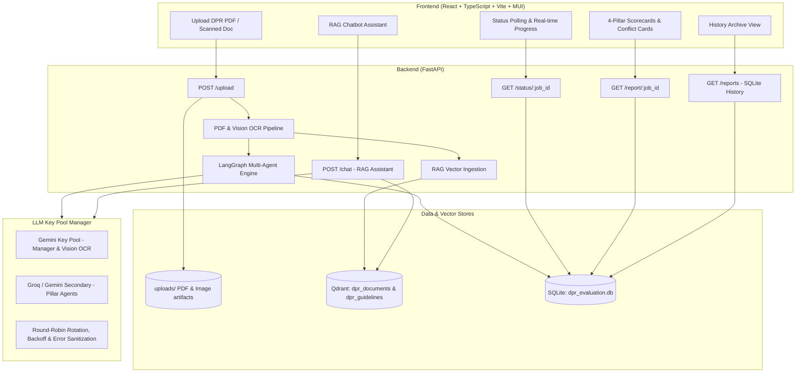
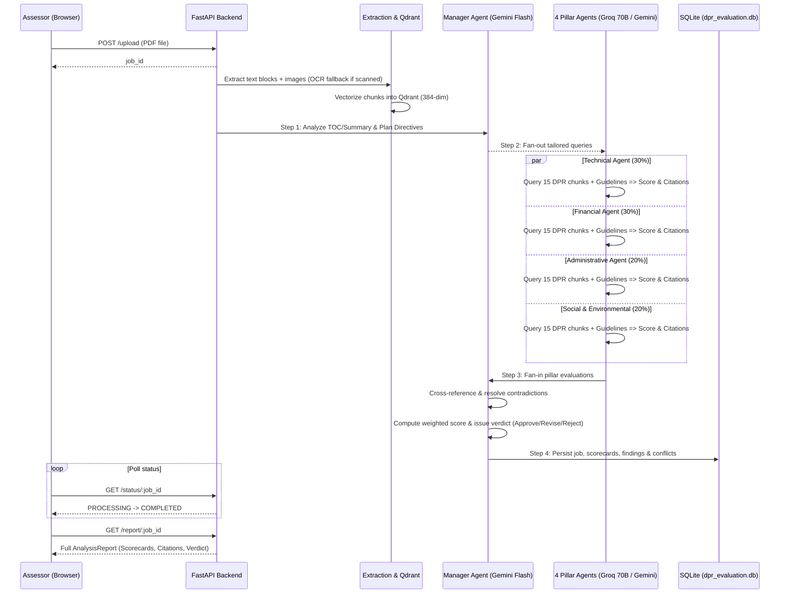

# DPR Compliance Analysis System - Architecture and Working Guide

This document explains the architecture, the LangGraph multi-agent orchestration pipeline, and how each component evaluates Detailed Project Reports (DPRs) against NE-SIDS / MDoNER standards.

---

## 1. Objective

The system automates the evaluation of Detailed Project Reports (often 200+ pages) for infrastructure projects funded under the **NE-SIDS (North East Special Infrastructure Development Scheme)** by MDoNER.

Primary capabilities:
- **PyMuPDF text extraction + Gemini Vision OCR fallback** for scanned pages
- **Semantic retrieval** with local Sentence-Transformers embeddings (`all-MiniLM-L6-v2`, 384-dim) and local Qdrant collections
- **LangGraph Multi-Agent Architecture**: 4 specialized pillar agents (Technical, Financial, Administrative, Social) running in parallel, orchestrated by 1 Manager Agent
- **Conflict Resolution & Weighted Scoring**: Manager reconciles cross-pillar discrepancies and calculates a formal composite score and verdict (Approve / Revise / Reject)
- **Persistent Storage**: SQLite database (`dpr_evaluation.db`) for job history, pillar evaluations, page-cited findings, and conflict logs
- **Modern React Dashboard**: Material-UI frontend with independent pillar scorecards, page citations, conflict resolution cards, and backend history

---

## 2. High-Level Architecture

---

## 3. The LangGraph Multi-Agent Workflow

---

## 4. Scoring Rubric & Decision Rules

Composite score formula:
$$\text{Score} = (0.30 \times \text{Technical}) + (0.30 \times \text{Financial}) + (0.20 \times \text{Administrative}) + (0.20 \times \text{Social})$$

- **Approve**: Composite score $\ge 75/100$, no single pillar $< 60/100$, and no critical unresolvable blockers.
- **Revise**: Composite score $50 - 74/100$, or any pillar between $40 - 59/100$, or fixable contradictions (returned to department with page citations).
- **Reject**: Composite score $< 50/100$, or any pillar $< 40/100$, or statutory non-compliance.

---

## 5. Storage Model

- **Database**: `dpr_evaluation.db` (SQLite in WAL mode)
  - `jobs`: Overall job status, composite score, verdict, timing, executive summary
  - `pillar_evaluations`: Per-pillar scores, weights, narrative summaries, guideline status, metrics
  - `findings`: Granular items with mandatory `dpr_page` citations, severity, and guideline references
  - `conflicts`: Cross-pillar contradictions reconciled by the Manager
  - `guideline_meta`: Metadata for ingested guideline documents
- **Vector DB**: `local_qdrant_data/`
  - `dpr_documents`: 384-dim dense vectors tagged with `job_id` and `page`
  - `dpr_guidelines`: 384-dim dense vectors tagged with `pillar`, `page`, and `source_doc`
